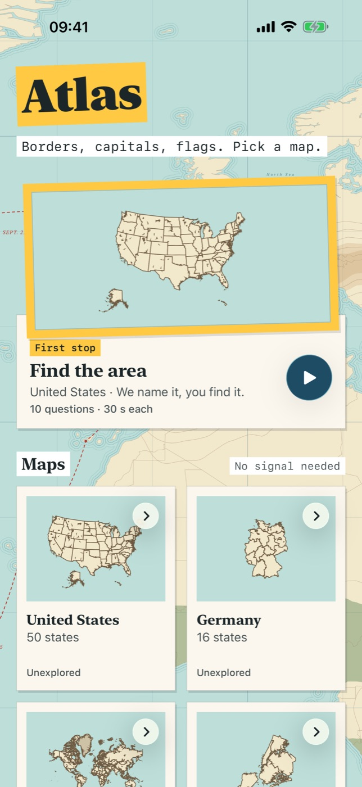
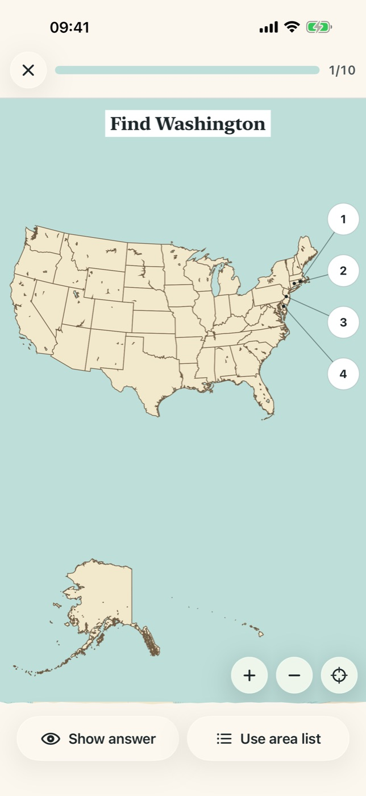
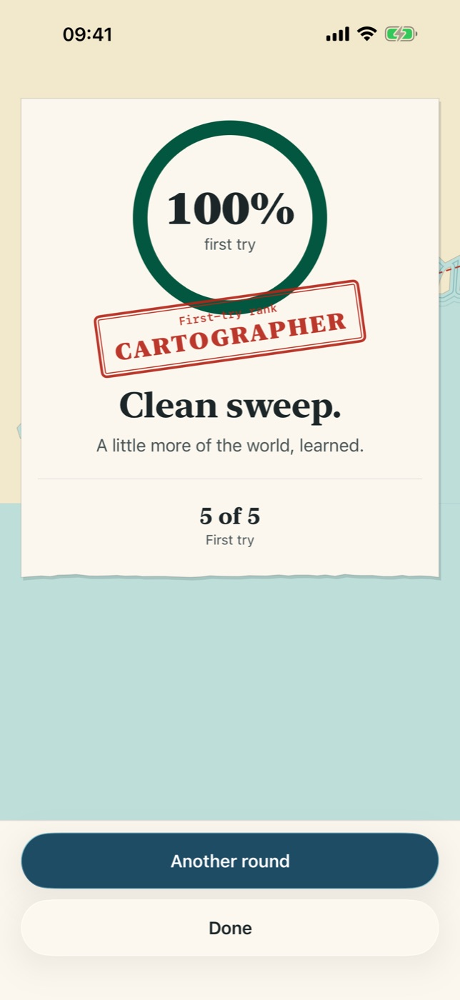

# Atlas Practice

Atlas Practice is a geography practice app for iPhone and iPad: the US states, the German states, and New York City's boroughs and neighborhoods. It works offline and needs no account.

<p>
  
  
  
</p>

- **Maps:** the 50 US states, the 16 German states, the 197 countries of the world, and New York City's five boroughs and 53 neighborhood areas.
- **Ten ways to play the US and German maps:** Find the area, Name the area, State capitals, State flags, Nicknames & slogans, Locate capitals, Locate cities, City populations, Locate landmarks, and Beat the clock. The world and New York City maps have Find the area, Name the area, and Beat the clock.
- **Beat the clock:** a timed challenge on every map. Pin 15 places with 15 seconds each; a closer and faster pin keeps more of the 1,000 points per place, and each map remembers its high score. The world map asks for 148 major cities, New York City for 56 sights, squares and bridges, and the US and German maps for their cities and landmarks.
- **Rounds and rematches:** in Settings, choose 10, 25 or all questions per round, and no timer or a 30- or 60-second countdown per question (default: 10 questions, 30 s). A missed question comes back once for a rematch.
- **Ranks:** the first-try score earns a rank, from Wanderer to Cartographer.
- **Browse facts:** the capitals, flags, cities and sights behind the US and German questions, each with its source.
- **Settings:** the round options above, reset progress, help and privacy links, and map sources and credits. Progress stays on the device.

Coming soon to the App Store as Atlas Practice.

[Website](https://atlas-practice.app/) · [Privacy](https://atlas-practice.app/privacy/) · [Support](https://atlas-practice.app/support/) · [Report a problem](https://github.com/jkrenge/atlas-practice/issues/new/choose) · Licence: [LICENSE](LICENSE) and [NOTICE.md](NOTICE.md)

## Build and run

Requires macOS with Xcode 26 or later (iOS 26 SDK). Last verified with Xcode 27.2 and the iOS 26.5 Simulator. The app targets iOS 18.0 and uses Swift 6 language mode. It needs no third-party app packages and no server.

Open `ios/Atlas.xcodeproj`, select the **Atlas** scheme and an iOS Simulator, then run. Or use the script:

```sh
scripts/ios.sh build
xcrun simctl list devices available
# Replace SIMULATOR_UDID with an available device identifier.
scripts/ios.sh run SIMULATOR_UDID
```

Build products and test results stay under ignored `build/`. To run on an iPhone, see [device installation](ios/DEVICE_INSTALL.md).

The generated Xcode project is committed, so XcodeGen (install with `brew install xcodegen`) is only needed when changing `ios/project.yml` or adding source files. To regenerate the project, use XcodeGen 2.46 or compatible and `scripts/ios.sh generate`.

## Tests

`scripts/ios.sh test SIMULATOR_UDID` runs the unit (Swift Testing) and UI (XCTest) suites serially, without signing. `testStoreScreenshots` skips unless `scripts/screenshots.sh` runs it. There is no CI for tests; `.github/workflows/pages.yml` only deploys the website.

The data validators are under [Data](#data). Dated test and device runs are logged in [ios/VERIFICATION.md](ios/VERIFICATION.md).

## Interface

The interface looks like a school atlas lying on the table. One world map, drawn on device from the bundled Natural Earth countries, sits under every screen: teal water with engraved water-lining along the coasts, beige land, soft forest and highland tints, invented contour lines, a fine 10° graticule, italic ocean names and a few red voyage routes. Each screen points a camera at a different place (the Atlantic on home, the map's region for a pack, the capital for a state, Greenwich for the credits) and the map glides there; scroll views drift it slightly. Information sits on square paper cards with a hard shadow or on solid label tape behind each line of text, like an explainer video; yellow is kept for the title strip, the exhibit frame around maps and flags, and a few label tapes (First stop, Start here, Rematch); red for the results rank stamp, wrong answers, the last five seconds of a countdown, and Reset progress. Controls are frosted Liquid Glass on iOS 26 with ink labels, solid paper on iOS 18 and with Reduce Transparency. Every text button and answer is the same 54 pt pill; icon buttons and map markers are 44 pt circles. Feedback headlines rotate deterministically, streaks get their own lines, and VoiceOver hears the plain outcome first. Motion is one-shot and off with Reduce Motion.

## Data

All playable geometry uses GeoJSON with WGS 84 longitude and latitude coordinates. Map manifests use schema version 2; see [MAP_FORMAT.md](MAP_FORMAT.md).

| Map | Geometry features | Question areas |
| --- | ---: | ---: |
| United States | 51 | 50 states; DC is background |
| Germany | 16 | 16 federal states |
| NYC boroughs | 5 | 5 boroughs |
| NYC neighborhoods | 53 | 38 Manhattan areas plus 15 outside Manhattan |
| NYC statistical neighborhoods | 262 | 197 residential 2020 NTAs |
| World | 242 | 197 countries |
| Africa | Shared world geometry | 52 |
| Asia | Shared world geometry | 48 |
| Europe | Shared world geometry | 45 |
| North America | Shared world geometry | 23 |
| South America | Shared world geometry | 12 |
| Oceania | Shared world geometry | 14 |

The app shows the first four maps and World. State and country geometry excludes mapped lakes from Natural Earth physical layers at the same scale as its boundaries: 1:10 million for states and 1:50 million for countries. These are generalized learning maps, not survey-grade maps.

The World list has 197 questions: the 193 UN member states, the two UN observer states, Kosovo and Taiwan. Dependencies, constituent countries such as Greenland, and other territories are drawn as background. Boundaries and continent labels follow Natural Earth, which generally maps de facto control. The six continent lists contain 194 questions in total: the source places Seychelles, Mauritius, and Maldives in `Seven seas (open ocean)`, so they appear only in the World list. The continent packs are not in the app. There is no Antarctica country quiz.

The home screen lists the US, Germany and the World, plus one New York City card that opens a city page with two maps: the boroughs and the focused neighborhood pack. The separate official NTA dataset remains a statistical reference. Chinatown, Nolita, Tribeca, and Financial District have separate geometry in the neighborhood game. Manhattan keeps all 37 source areas, plus Seaport, hand-drawn out of the Financial District (see [carve-outs](data/nyc-carve-outs.json)). Bed-Stuy, DUMBO, Williamsburg, Greenpoint, Park Slope, Prospect Heights, Downtown Brooklyn, Crown Heights, Prospect Park, and Long Island City stay separate. West Brooklyn, South & East Brooklyn, and Queens (other areas) combine the remaining Brooklyn and Queens neighborhoods. The Bronx and Staten Island each use one official borough polygon. These broad groups are practice areas. The unmodified mirror remains in `data/candidates`; repairs occur before grouping. Each practice area is then clipped to its own official borough shoreline. This preserves membership and inland divisions but does not fill source gaps. See [group membership](data/nyc-learning-groups.json). Neighborhood boundaries are approximate and include parks and islands; whether the mirror matches the licensed download is unconfirmed (see [source notes](data/SOURCES.md)). The focused map has a new ID, so earlier scores from the 266-area map stay separate.

`content/learning.json` contains 66 state facts, 60 ranked cities, 70 curated sights, and the Beat the clock places for the maps without such facts: 148 world cities from Natural Earth and 56 New York City sights from Wikidata. State flags are bundled PNGs from Wikimedia Commons with file-specific credits. US city populations use Census Vintage 2025, 2025-07-01; German cities use Destatis, 2024-12-31. These are city/municipal populations, not metro areas. US consolidated-government balances and Washington, DC follow the Census ranking. Landmarks form a curated learning list, not a measured popularity ranking. Each point has a source link, and park reference points are labeled.

The older `data/us-cities.geojson` remains a cartographic reference with 769 Natural Earth city/town points. Its population fields do not feed the city games.

### Rebuild and validate

Needs Python 3.10 to 3.14 (the initial build was verified with Python 3.14; shapely 2.1.2 has no Python 3.15 build, so if `python3` is newer, create the environment with `python3.14`) and Node.js 20.11 or later with npm, for the pinned mapshaper in `scripts/geometry/package-lock.json`. Run the diff check on a clean checkout.

```sh
python3 -m venv .venv
.venv/bin/python -m pip install -r requirements-data.txt
npm ci --prefix scripts/geometry
.venv/bin/python scripts/compile_maps.py
.venv/bin/python scripts/validate_data.py
.venv/bin/python scripts/compile_learning.py
.venv/bin/python scripts/validate_learning.py
git diff --exit-code -- maps content data/us-cities.geojson data/candidates/nyc-neighborhoods.geojson data/nyc-neighborhood-repairs.json data/geometry-simplification.json
```

Compilation reads the committed snapshots and checks their hashes before writing output. It does not download data or replace the checksum lock. The validation checks references, expected area sets, geometry structure and topology, coordinate bounds, and representative city points. The final command checks that compilation reproduced the committed output exactly.

Map compilation also runs `scripts/simplify_maps.py`. It uses shared-edge Douglas–Peucker simplification, with tighter limits for small rings and known water points. Each feature's changed area is limited to 1%. Original geometry remains available for source checks; iOS bundles only the simplified assets. `data/geometry-simplification.json` records point counts and file sizes. Both rendering and answer selection use the same reduced geometry.

Keeping source snapshots in Git makes the data build independent of upstream updates, API row order, and download availability. The virtual environment is excluded.

## Website

`website/` is the public site (home, support, privacy, credits) for GitHub Pages: plain HTML and one stylesheet, deployed by `.github/workflows/pages.yml`. [website/README.md](website/README.md) covers the local preview, deployment, regenerating the pictures, and the placeholders to fill before launch.

## Files

- [LICENSE](LICENSE): the MIT License for the code.
- [NOTICE.md](NOTICE.md): third-party data and its licences.
- [PROJECT_PLAN.md](PROJECT_PLAN.md): Implementation status, limits and backlog.
- [AGENTS.md](AGENTS.md): Rules for coding agents and contributors: this repository is public.
- [MAP_FORMAT.md](MAP_FORMAT.md): Data contract and required coordinate handling.
- [ios/DEVICE_INSTALL.md](ios/DEVICE_INSTALL.md): Building and installing on an iPhone.
- [ios/VERIFICATION.md](ios/VERIFICATION.md): Dated log of verification runs.
- `maps/catalog.json`: Index of the twelve prepared map packs.
- `maps/*/map.json`: Question IDs, names, and relative geometry references.
- `maps/*/areas.geojson`: Full source-derived geometry retained for validation.
- `maps/*/areas-lowres.geojson`: Simplified geometry used by the app for rendering and selection.
- `data/sources/`: Original source snapshots, committed for reproducible builds.
- `data/source-checksums.json`: SHA-256 lock for the nine geographic snapshots.
- [data/SOURCES.md](data/SOURCES.md): Source URLs, versions, terms, and selection rules.
- [data/MAP_REVIEW.md](data/MAP_REVIEW.md): Review of all 12 packs, shoreline corrections, and limits.
- [data/VALIDATION.md](data/VALIDATION.md): What the data validators check.
- `data/nyc-learning-groups.json`: The 15 NYC practice areas outside Manhattan and their source members.
- `data/nyc-carve-outs.json`: The hand-drawn Seaport outline.
- `data/us-cities.geojson`: Retained Natural Earth city Point features.
- `content/learning.json` and `content/flags/`: Offline game facts and authentic flag images.
- `data/learning/`: Reviewed identities, selections, slogan sources, and flag metadata.
- `data/learning-checksums.json`: Locks the fact source snapshots, curation, and flag assets.
- `assets/us-states.svg` and `maps/us-states/map.svg`: Original and adapted visual references.
- `scripts/ios.sh`: Generate, build, test, and run the app.
- `scripts/app_icon.swift`: Draws the app icon and the website's map.
- `scripts/screenshots.sh`: App Store and website screenshots on fresh simulators.
- `website/`: The public website (see [Website](#website)).

The SVG is decorative reference material. It has no verified registration to geographic coordinates. Use the GeoJSON for rendering and tap detection. Do not use SVG pixels to locate cities or measure distance.

## App structure

- `ios/Atlas/AtlasApp.swift`: app entry, the home screen, the NYC city page, map pages, practice, study, results, Settings, and Sources.
- `ios/Atlas/AtlasBackdrop.swift`: the shared world-map backdrop and its cameras.
- `ios/Atlas/AtlasCollage.swift`: paper cards, label tape, and the rank stamp.
- `ios/Atlas/MapData.swift`: schema-version-2 manifests and Polygon/MultiPolygon decoding, including shared geometry paths.
- `ios/Atlas/MapGeometry.swift`: projection, inset fitting, viewport transforms, and polygon hit testing.
- `ios/Atlas/MapView.swift`: native map drawing, previews, and touch gestures, with SwiftUI zoom controls; also the app's colors.
- `ios/Atlas/PracticeSession.swift`: question queue, spaced review, scoring, feedback lines, ranks, and local progress.
- `ios/Atlas/LearningContent.swift`: fact database loading and geographic distance.
- `ios/Atlas/ReferenceScreen.swift`: Browse facts.
- `ios/Atlas/PrivacyInfo.xcprivacy`: privacy manifest (no tracking; crash, diagnostic and usage data and feedback, not linked to the user).
- `ios/AtlasTests` and `ios/AtlasUITests`: geometry/session checks and Simulator interaction tests.

The lower 48 use Albers equal-area with standard parallels 29.5°/45.5°, central longitude −96°, and origin latitude 37.5°. Alaska and Hawaii use separate equirectangular view regions centered at −154°/64° and −157°/20°. Longitude wrapping around Alaska preserves the Aleutian Islands across ±180°. Germany and NYC use an equirectangular projection centered on their geometry. The world uses the Mercator projection centered on 0°, with latitude clamped to 85°N and 76°S; the source cuts polygons at ±180°, so nothing wraps. Every view is fitted to its question areas, so on the world map Antarctica runs off the lower edge. Each region has an explicit inverse; uniform fitting preserves aspect ratio. The five exposed map layouts are tested. The continent views need a separate camera review before exposure.

Callout boxes are fixed 44-point touch targets. Their leader lines follow the projected shape as the map moves. Before feedback, the markers display neutral numbers. Water, holes, and DC do not submit state answers. A tap within 3 screen points of another eligible area is treated as ambiguous and asks the player to zoom in.

Location questions use a movable pin. Point questions accept water and coastlines inside a geographic map region. Gaps between US insets cannot submit a point. Distance uses the haversine formula on canonical longitude/latitude, not screen pixels; within 50 km on the US map or 20 km on the German map counts as correct. Map zoom supports up to 32×.

A round uses the question count from Settings, capped at the places available. A first miss or Show answer inserts one review after two other queued questions when possible. A review is attempted once, so a round always ends. First-attempt results and review results remain separate. Scores are stored per map, mode, and timer setting; the app shows their total. The area list supports non-spatial selection in Find mode; it does not provide equivalent spatial learning for a person who cannot see the map.

Beat the clock ignores the round settings: 15 places, 15 seconds each, one pass with no reviews. A place scores `round(accuracy × (700 + 300 × share of the clock left))`, where accuracy is `(1 − distance ÷ range)²` and the range is 3,000 km on the world map, 1,000 km in the US, 300 km in Germany, and 10 km in New York City. A pin within a tenth of the range counts as on target. If the clock runs out with a pin on the map, that pin is scored; without one the place scores nothing. The best total per map is stored as its high score.

Countdowns pause while the app is inactive and during answer feedback, and a timed question can be paused by hand. A timeout records one miss and one review. The coordinate-entry sheet provides an accessible alternative to pin placement.

## Licence

The code is under the MIT License ([LICENSE](LICENSE)). Map data, facts, flags and other third-party content keep their own licences: see [NOTICE.md](NOTICE.md) and [data/SOURCES.md](data/SOURCES.md).
